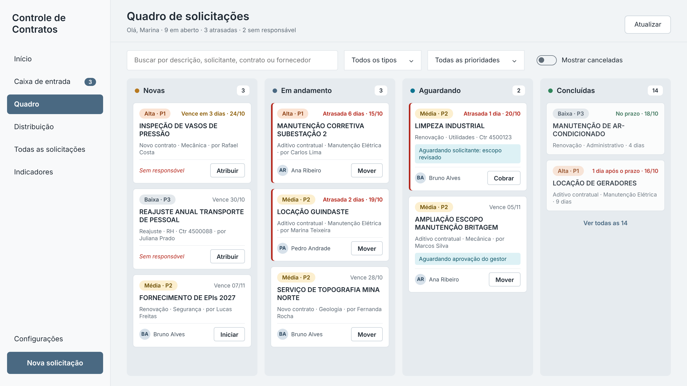
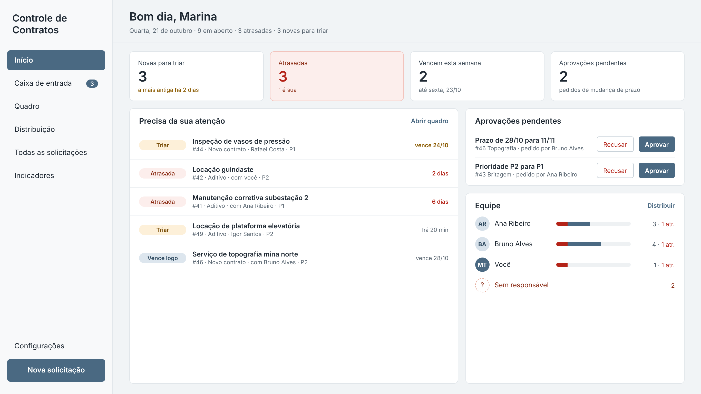
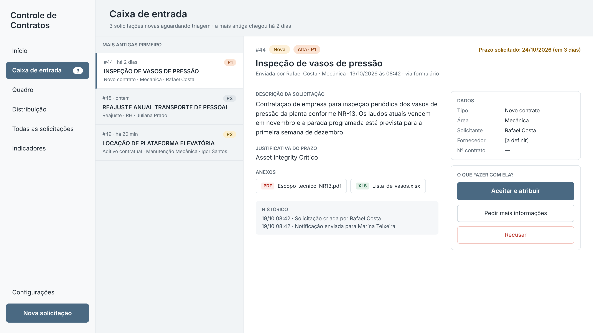
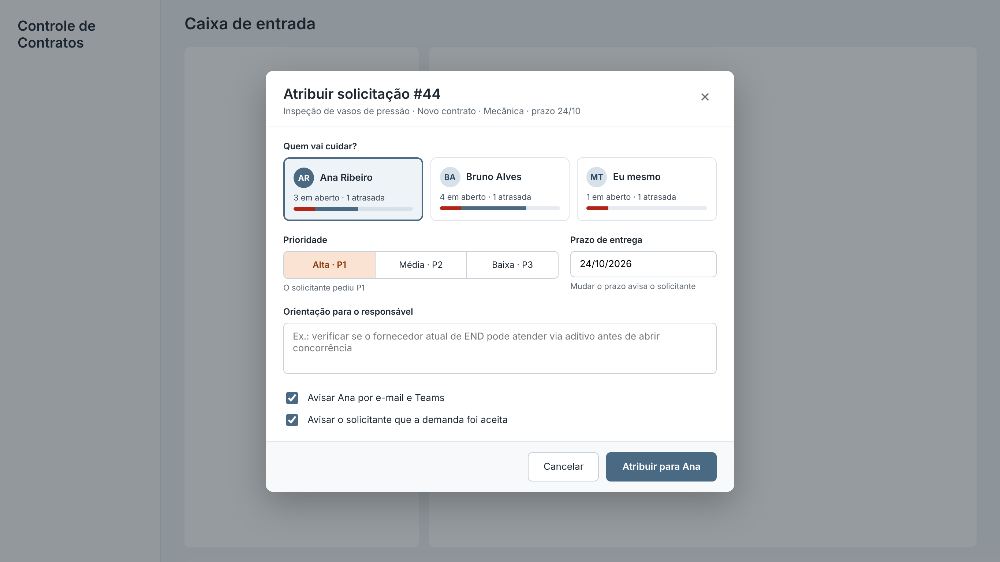
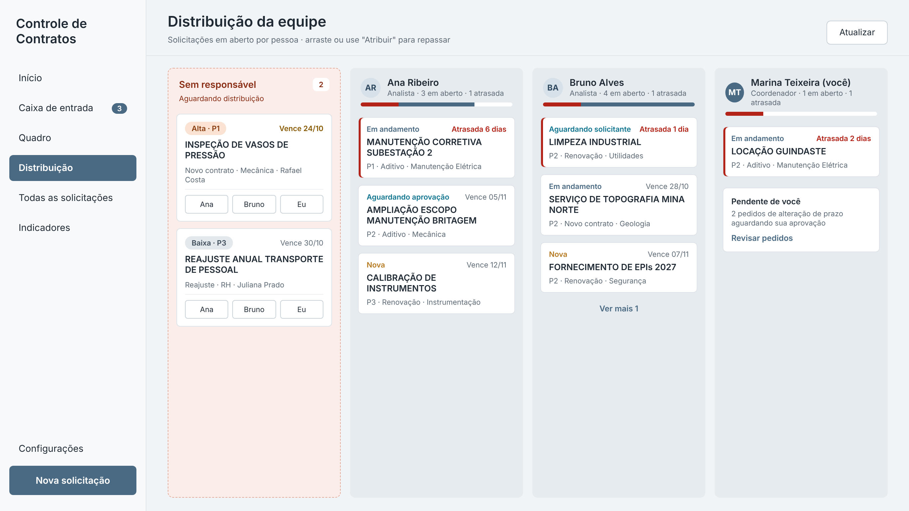
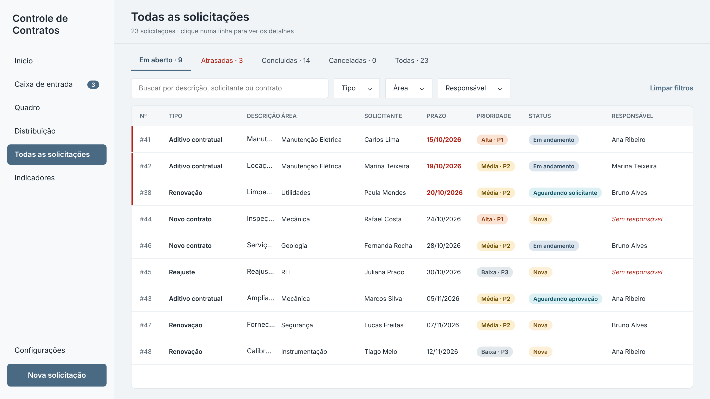
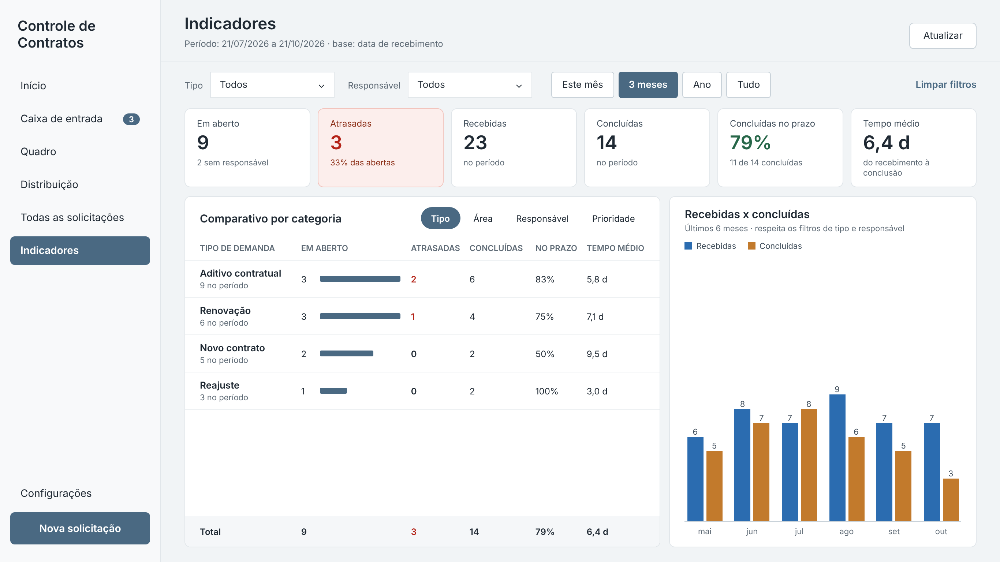
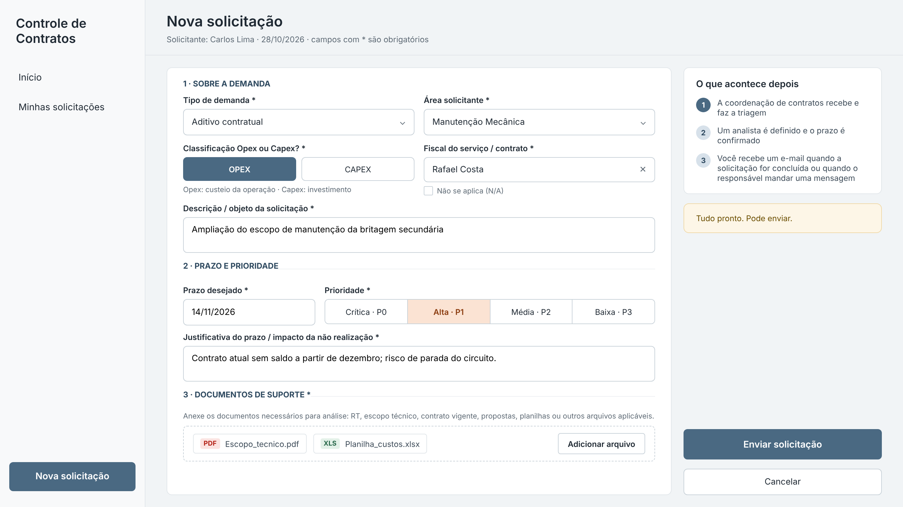
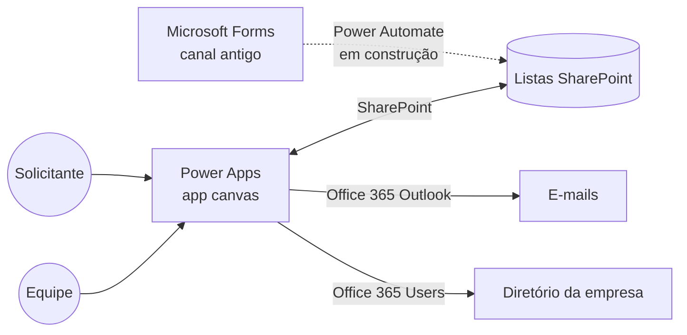
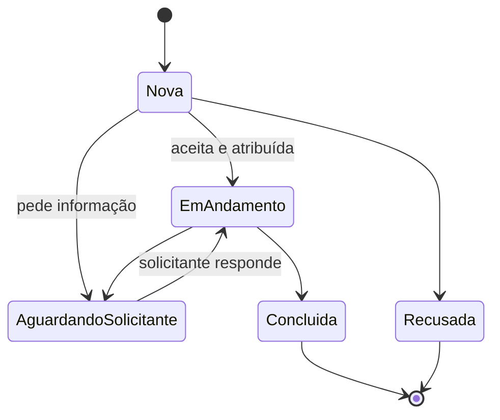

# Controle de Contratos · Power Apps

Aplicativo canvas em **Power Apps** para receber, distribuir e acompanhar solicitações de contratos e custos de uma gerência de manutenção. Substitui o fluxo "Microsoft Forms → planilha/lista" por um painel único onde a coordenação faz a triagem, atribui analistas, controla prazos e aprovações, e o solicitante acompanha tudo e recebe retorno por e-mail.



> **Sobre as imagens:** todos os nomes, números de contrato e indicadores são fictícios. As telas mostradas são os protótipos de alta fidelidade do projeto; o aplicativo em produção segue o mesmo layout.

---

## O problema

As solicitações chegavam por um Microsoft Forms e caíam numa lista do SharePoint. A partir daí, tudo era manual:

- ninguém sabia com quem estava cada demanda nem em que etapa ela estava;
- o solicitante não tinha retorno: para saber o andamento, precisava perguntar;
- mudanças de prazo e prioridade aconteciam por conversa, sem registro;
- a gestão não tinha números (tempo de atendimento, atrasos, volume por tipo).

## A solução

Um app com dois públicos e permissões diferentes:

| Perfil | O que faz |
|---|---|
| **Solicitante** (qualquer pessoa da empresa) | Abre a solicitação com anexos, acompanha o andamento numa linha do tempo e responde quando a equipe pede informação. |
| **Analista** | Trabalha as demandas no quadro Kanban, muda status, conversa com o solicitante e pede alteração de prazo. |
| **Coordenador** | Faz a triagem da caixa de entrada, atribui e redistribui demandas, aprova pedidos de prazo e administra a equipe. |
| **Gestor** | Acompanha o andamento geral e os indicadores. |

O perfil vem de uma lista de equipe no SharePoint. Quem não está nela entra direto como solicitante e só vê as próprias solicitações.

---

## Telas

| | |
|---|---|
|  **Início** · o que precisa de atenção hoje, aprovações pendentes e carga da equipe |  **Caixa de entrada** · triagem das novas: aceitar e atribuir, pedir informação ou recusar |
|  **Atribuir** · escolha do responsável, prioridade, prazo acordado e aviso por e-mail |  **Quadro** · Kanban por status com destaque de atraso e ações rápidas |
|  **Distribuição** · demandas por pessoa, para equilibrar a carga e repassar |  **Todas as solicitações** · tabela com abas, filtros e painel de histórico |
|  **Indicadores** · KPIs do período, comparativo por tipo, área, Opex/Capex, responsável e prioridade |  **Nova solicitação** · formulário com validação em tempo real e anexos obrigatórios |

Também fazem parte do app as telas **Minhas solicitações** (visão do solicitante, com linha do tempo e caixa de resposta) e **Configurações** (cadastro da equipe, papéis e ordem).

---

## Funcionalidades

- **Triagem** com três decisões: aceitar e atribuir, pedir mais informações (a demanda fica "Aguardando solicitante") ou recusar com motivo.
- **Kanban** com quatro colunas (Novas, Em andamento, Aguardando, Concluídas), busca, filtros e destaque de atraso.
- **Prioridades P0 a P3**, com cores próprias. P0 (crítica) aparece sempre no topo e chega com `[CRÍTICA]` no assunto do e-mail.
- **Pedidos de mudança de prazo**: o analista pede um novo prazo com justificativa e o coordenador aprova ou recusa pela tela inicial. A decisão fica registrada no histórico.
- **Histórico completo** de cada solicitação: quem fez o quê e quando, com valor anterior e novo.
- **E-mails automáticos** (HTML) para o solicitante quando a demanda é aceita, quando a equipe pede informação e quando é concluída; e para a coordenação quando chega uma nova.
- **Seletor de pessoas** ligado ao diretório da empresa, com filtro por todas as palavras digitadas (resolve nomes no formato "Sobrenome, Nome").
- **Indicadores**: em aberto, atrasadas, recebidas, concluídas, % no prazo e tempo médio, com filtro por período, tipo e responsável, e gráfico dos últimos 6 meses.
- **Controle de acesso** por papel: menu, telas e ações aparecem conforme o perfil, com bloqueio em cada tela da equipe.

---

## Arquitetura



**Fonte de dados:** quatro listas do SharePoint (Microsoft Lists).

| Lista | Função | Principais colunas |
|---|---|---|
| `SolicitacoesContrato` | As solicitações | Código (`SC-AAAA-0000`), Tipo, Área, Classificação (Opex/Capex), Fiscal (pessoa), Descrição, Prazo solicitado/acordado, Justificativa, Prioridade, Status, Solicitante, Responsável, datas de recebimento/atribuição/conclusão, anexos |
| `HistoricoSolicitacoes` | Log de tudo que acontece | Solicitação, Ação, Campo alterado, Valor anterior, Valor novo, Mensagem, Usuário, Data/hora |
| `PedidosAlteracao` | Aprovações de mudança de prazo | Solicitação, Campo, Valor atual, Valor proposto, Motivo, Solicitado por, Aprovador, Status do pedido |
| `EquipeContratos` | Equipe e permissões | Usuário, Papel (Coordenador, Analista, Gestor), Ativo, Ordem |

**Ciclo de vida de uma solicitação**



Pedidos de mudança de prazo correm em paralelo: a demanda continua "Em andamento" enquanto o pedido aguarda a decisão do coordenador na lista `PedidosAlteracao`.

---

## Decisões técnicas

- **Telas escritas como código (YAML).** Todas as telas foram escritas em Power Apps YAML (`src/telas`) e coladas no Studio. Isso permitiu versionar, revisar e reaplicar mudanças de forma controlada, em vez de arrastar controles à mão.
- **Uma única fonte que conhece as colunas.** As *named formulas* em `App.Formulas` (`nfSol`, `nfEquipe`, `nfPedidos`, `nfPapel`…) normalizam os dados da lista em colunas com nomes estáveis (`StatusTxt`, `DtPrazo`, `Atrasada`, `OrdemPrio`…). As telas só usam essas colunas: se uma coluna da lista mudar, a correção é feita em um lugar.
- **Regras calculadas uma vez.** Atraso, dias de atraso, "concluída no prazo", tempo de atendimento e a coluna do Kanban são campos calculados em `nfSol`, reaproveitados pelo quadro, pela tabela e pelos indicadores.
- **Tema centralizado.** Cores e rótulos de prioridade vivem em tabelas nomeadas (`nfPrioridades`, `cor*`), seguindo o padrão visual de outro app interno.
- **Somente controles clássicos.** Escolha deliberada pela estabilidade: os controles modernos causaram problemas de compatibilidade num app anterior.
- **Anexos via formulário.** O controle de anexos solto não entrega o tipo que o SharePoint exige no `Patch`. O app cria o item com `SubmitForm` de um formulário mínimo e completa os demais campos no `OnSuccess`.
- **Ambiente em en-US, interface em pt-BR.** Separadores `,`/`;` nas fórmulas e datas sempre formatadas explicitamente (`dd/mm/yyyy`).
- **Permissões.** O controle de acesso do app esconde telas e ações; o isolamento de dados é feito pelas permissões das listas no SharePoint.

---

## Estrutura do repositório

```
├── docs/img/                 imagens das telas (dados fictícios)
└── src/
    ├── 1_App_Configuracao.txt        passo a passo, App.Formulas e StartScreen
    ├── 10_scrNova_Anexo_Form.txt     montagem do formulário de anexos
    └── telas/
        ├── 2_BarraLateral.yaml       menu da equipe
        ├── 9_BarraSolicitante.yaml   menu do solicitante
        ├── 3_scrInicio.yaml
        ├── 4_scrCaixa.yaml
        ├── 5_scrQuadro.yaml
        ├── 6_scrDistribuicao.yaml
        ├── 7_scrTodas.yaml
        ├── 8_scrIndicadores.yaml
        ├── 10_scrNova.yaml
        ├── 11_scrMinhas.yaml
        ├── 12_scrConfig.yaml
        └── 15_Bloqueio.yaml          bloqueio das telas da equipe
```

## Como reproduzir

1. Crie as quatro listas no SharePoint com as colunas da tabela acima.
2. Crie um app canvas, adicione as listas e os conectores **Office 365 Outlook** e **Office 365 Users**.
3. Siga `src/1_App_Configuracao.txt`: crie as telas com os nomes indicados e cole as fórmulas em `App.Formulas`.
4. Em cada tela, cole a barra lateral e depois o YAML da tela (selecione a tela, Ctrl+V).
5. Monte o formulário de anexos da tela de nova solicitação conforme `src/10_scrNova_Anexo_Form.txt`.
6. Cadastre a equipe na lista `EquipeContratos` e publique.

## Próximos passos

- Fluxo no Power Automate para importar as respostas do Forms antigo durante a transição.
- Lembrete diário por e-mail das demandas atrasadas.
- Permissão por item nas listas, para que cada solicitante leia só o que criou.

---

**Stack:** Power Apps (canvas, Power Fx, YAML) · SharePoint / Microsoft Lists · Power Automate · Office 365 Outlook · Office 365 Users
